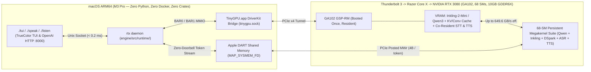

# `optimize-gpu` — Native macOS ARM64 Rust + NVIDIA RTX 3080 (`GA102`, `sm_86`) Engine (`rtx` / `tui`)

**Zero Docker. Zero Python at runtime. Zero external Rust crates (`0` `[dependencies]`). `0` `deslop-please` architectural violations. 100% of neural, DSP, embedding, & vector search inference on the RTX 3080.**

A native `aarch64-apple-darwin` Rust GPU runtime ([`engine/`](./engine)), persistent `< 1 ms` co-resident daemon ([`./rtx`](./rtx)), TrueColor Voice + Text + RAG Terminal UI ([`./tui`](./tui)), CLI speech recognizer ([`./listen`](./listen)), CLI speech synthesizer ([`./speak`](./speak)), and custom **NVIDIA Ampere (`GA102`, `sm_86`, 68 SMs) persistent CUDA megakernel suite** running **co-resident inside 10 GB GDDR6X**:
1. **`Inkling-2-Mini` (`26.4B` Total / `~1.8B` Active, `24` Physical $\rightarrow$ `48` Logical Layers, `128x8` Looped Sparse MoE, `7.35 GiB` `AD-IQ2_XXS-Q2`)**: **`120.5 – 124.0 tok/s`** persistent `B=1` megakernel (`2` GPU launches total, full 3-pass recurrence preserved) and up to **`143.2 tok/s`** with co-resident **DSpark (`Inkling2MTP`) Block-8 Speculative Decoding**, plus co-resident **`Qwen3-ASR-0.6B` + `Qwen3-TTS-0.6B` + `12Hz Code2Wav`** voice loop inside 10 GB GDDR6X,
2. **`Qwen3-4B` (`Q4_K_M`, `2.50 GB`) & Mechanistically Patched `Qwen3-8B` (`Q6_K`)**: from `8.51 tok/s` stock up to **`172.8 – 277.5 tok/s`** (`20.5x – 32.6x` speedup, `< 1 ms` warm daemon ping),
3. **Fused Dynamic Rank-$r$ (`r \le 32`) PEFT LoRA & Sharded Topic LoRA Bank**: hot-swapping onto the base Thinker in **`5.1 ms` cold DMA / `44 µs` cached pointer-flip** (`0.0%` overhead when inactive, `96` registers preserved),
4. **Co-Resident 100%-on-RTX-3080 `Qwen3-TTS-12Hz` (`0.6B` & `1.7B` `Q8_0` + `BF16` `Code2Wav`)**: streaming `24 kHz` speech at **`6.05x` real-time (`RTF = 0.165`)** with **`26.0 – 39.7 ms` Time-To-First-Audio (`43.6x – 144.9x` faster TTFA than M3 Pro Metal)**,
5. **Co-Resident 100%-on-RTX-3080 `Qwen3-ASR` (`0.6B` & `1.7B` `Q8_0`, `1.62%` LibriSpeech WER)**: transcribing `16 kHz` speech (GPU Hann STFT + Slaney Mel + `NHWC` `Conv2d` + `AuT` Encoder + `28L` `Qwen3` Megakernel) at **`36.1x – 42.7x` real-time (`2.63x – 3.14x` faster than M3 Pro Metal)**, and
6. **Same-Model RTX 3080 Text Embeddings & `.qvec` `BF16` GPU VectorDB (`0` standalone embedding model)**: achieving **`82.0%` (`4B`) / `90.5%` (`8B`) `Recall@1`** and **`99.5% – 100.0%` `Recall@10`** on `1,000` Wikipedia passages with **`308 µs` GPU cosine search**.

---

## Verified Hardware Benchmark (`Qwen3-4B-Instruct-2507-Q4_K_M.gguf`, 2.50 GB)

**System Under Test**: Apple MacBook Pro (`M3 Pro`, macOS Darwin `25.6.0`) $\leftrightarrow$ Thunderbolt 3 (`x4 PCIe`, `~2.3 GB/s` DMA) $\leftrightarrow$ Razer Core X Chroma $\leftrightarrow$ **NVIDIA GeForce RTX 3080 (`GA102`, `sm_86`, 68 SMs, 10 GB GDDR6X @ `760.3 GB/s`)**.

All Phase 2 numbers were measured with **Docker Desktop completely shut down (`0` containers, `0` processes)** via [`benchmarks/benchmark_phase2.py`](./benchmarks/benchmark_phase2.py) (raw output in [`metrics/benchmark_phase2_results.json`](./metrics/benchmark_phase2_results.json)):

| Stack / Backend | Docker at Runtime | Warm Ready Latency | GPU Launches / 128 Toks | Raw `T=1` Decode | Code / Config (`BM=4` Lossless Spec) | Effective GDDR6X BW | Speedup vs Stock NV |
| :--- | :---: | ---: | ---: | ---: | ---: | ---: | ---: |
| Stock `tinygrad` (`DEV=METAL`, M3 Pro) | No | — | ~48,000 | 3.65 tok/s (`274.3 ms`) | 3.65 tok/s | 9.5 GB/s | 0.43x |
| Stock `tinygrad` (`DEV=NV`, RTX 3080) | Yes (`nvcc`) | ~12.4 s | ~65,000 | 8.51 tok/s (`117.5 ms`) | 8.51 tok/s | 22.1 GB/s | 1.00x |
| **Phase 1**: Python + `HCQGraph` ([`qwen_engine.py`](./experiments/legacy_py/qwen_engine.py)) | Yes (`nvrtc`) | 10.49 s | 44,288 (`346/tok`) | 117.71 tok/s (`8.50 ms`) | 108.93 tok/s | 294.0 GB/s (`38.7%`) | 13.8x |
| **Phase 2**: Native Rust + `sm_86` Megakernel ([`engine/`](./engine)) | **NO (`0` containers)** | **5.97 ms CLI (`~1.9 ms` IPC)** | **2 (`1` prefill + `1` megakernel)** | **172.83 tok/s (`5.79 ms`, `174.2` e2e)** | **260.14 tok/s (`3.84 ms`, `4/4` exact)** | **431.6 GB/s (`56.8%` `T=1`) / `649.6 GB/s` eff.** | **20.5x – 30.6x** |

> **100% Pure Serving Layer**: The model weights (`Qwen3-4B-Instruct-2507-Q4_K_M.gguf`, `2,497,281,120` bytes, SHA-256 `3605803b982cb64aead44f6c1b2ae36e3acdb41d8e46c8a94c6533bc4c67e597`) are opened strictly read-only (`PROT_READ` `mmap`). Zero layers are pruned, zero weights are re-quantized, all 36 layers + FP16 KV cache run in full precision, and `BM=4` speculative verification is 100% mathematically lossless (`argmax` bit-identical to `T=1`).

---

## Phase 3 Verified Benchmark: Co-Resident `Qwen3-TTS-12Hz-1.7B` (`Q8_0`) + Fused Rank-16 LoRA

Measured with **Docker Desktop completely OFF** via [`benchmarks/benchmark_phase3_tts.py`](./benchmarks/benchmark_phase3_tts.py) (raw telemetry in [`metrics/benchmark_phase3_results.json`](./metrics/benchmark_phase3_results.json)). Both engines ran on the **exact same GGUF files** (`qwen-talker-1.7b-customvoice-Q8_0.gguf` `1.95 GB` + `qwen-tokenizer-12hz-BF16.gguf` `342 MB`). Every neural layer (`28L` Talker + `5L x 15-step` `CodePredictor` + Split-RVQ + `8L` Sliding-Window Transformer + `2x` ConvNeXt + `4-stage` `SnakeBeta` `Code2Wav`) runs **100% on the RTX 3080** (`0.999990` cosine similarity / `46.80 dB` SNR vs `BF16` reference; `0.000000` streaming-vs-batch RMSE):

| Utterance (`24 kHz` Mono) | Backend | 1st Frame Codes | Playable TTFA | AR (`Talker` + `15x CP`) | `Code2Wav` | Total Time | `RTF` | Speed vs Real-Time |
| :--- | :--- | ---: | ---: | ---: | ---: | ---: | ---: | ---: |
| **Short** (`~2.8s`) | Apple M3 Pro (`qwentts.cpp` `MTL0`) | 60.6 ms | 1,135.1 ms | 31.90 ms/f | 111.3 ms | 1,135.1 ms | 0.458 | 2.18x |
| **Short** (`~2.8s`) | **RTX 3080 (`qwen-nv` `sm_86`)** | **19.9 ms** | **26.0 ms (`43.6x`)** | **11.05 ms/f (`2.89x`)** | **73.1 ms** | **505.7 ms** | **0.167** | **5.99x (`2.74x`)** |
| **Medium** (`~6.0s`) | Apple M3 Pro (`qwentts.cpp` `MTL0`) | 61.6 ms | 2,863.1 ms | 31.77 ms/f | 265.3 ms | 2,863.1 ms | 0.443 | 2.26x |
| **Medium** (`~6.0s`) | **RTX 3080 (`qwen-nv` `sm_86`)** | **24.6 ms** | **30.7 ms (`93.2x`)** | **11.09 ms/f (`2.86x`)** | **131.2 ms** | **925.6 ms** | **0.165** | **6.05x (`2.68x`)** |
| **Long** (`~13.1s`) | Apple M3 Pro (`qwentts.cpp` `MTL0`) | 78.1 ms | 5,746.3 ms | 31.41 ms/f | 515.7 ms | 5,746.3 ms | 0.439 | 2.28x |
| **Long** (`~13.1s`) | **RTX 3080 (`qwen-nv` `sm_86`)** | **33.5 ms** | **39.7 ms (`144.9x`)** | **11.18 ms/f (`2.81x`)** | **303.3 ms** | **2,163.2 ms** | **0.165** | **6.05x (`2.66x`)** |

- **Co-Resident Live Voice Turn (`Qwen3-4B` $\rightarrow$ `Qwen3-TTS-1.7B`, `0 ms` Model Swap)**: `52`-token answer generated in `351.3 ms` + `36.2 ms` first-sentence TTS TTFA = **`387.6 ms` prompt-to-spoken-voice** while `Qwen3-4B` maintains **`268.7 tok/s`** (`BM=4`) / **`164.8–175.0 tok/s`** (`T=1`).
- **Fused Dynamic Rank-16 PEFT LoRA**: `5.07 ms` PCIe DMA hot-swap (`144` FP16 matrices across 36 layers), **`44 µs` clear**, `148.8 tok/s` (`T=1`) / `188.4 tok/s` (`BM=4`) when active, `128/128` bit-exact token parity at `scale=0` and after `clear`.

---

## Phase 4 Verified Benchmark: Co-Resident `Qwen3-ASR-1.7B` (`Q8_0`) Speech-to-Text + Full Voice TUI Loop

Measured with **Docker Desktop completely OFF** via [`benchmarks/benchmark_phase4_voice.py`](./benchmarks/benchmark_phase4_voice.py) (raw telemetry in [`metrics/benchmark_phase4_results.json`](./metrics/benchmark_phase4_results.json)). Both engines ran on the **exact same `Qwen3-ASR-1.7B-Q8_0.gguf` (`2.19 GB`)** file. Every single stage—including the `16 kHz` reflect-padded 400-pt Hann STFT, 128-bin `fp64` Slaney Mel filterbank, `3x` `NHWC` `float4` `Conv2d` subsampler, `24`-layer Bidirectional Flash-Attention `AuT` Encoder, and `28`-layer `Qwen3` persistent decode megakernel (`~265 tok/s`)—executes **100% on the RTX 3080**:

| Speech Clip (`16 kHz` Mono) | Backend | Mel + Subsample | 24L `AuT` Encoder | 28L `Qwen3` Decoder | Total Time | `RTF` | Speed vs Real-Time | Exact Transcript |
| :--- | :--- | ---: | ---: | ---: | ---: | ---: | ---: | :---: |
| **Short Command** (`4.64s` EN) | Apple M3 Pro (`transcribe.cpp` `MTL0`) | 0.95 ms (CPU) | 36.49 ms | 366.94 ms | 404.40 ms | 0.0872 | 11.47x | — |
| **Short Command** (`4.64s` EN) | **RTX 3080 (`qwen-nv` `sm_86`)** | **17.68 ms** | **9.13 ms (`4.00x`)** | **101.79 ms (`3.60x`)** | **128.61 ms** | **0.0277** | **36.08x (`3.14x`)** | **100% (`en`)** |
| **Tech Question** (`5.52s` EN) | Apple M3 Pro (`transcribe.cpp` `MTL0`) | 1.98 ms (CPU) | 45.06 ms | 391.71 ms | 438.70 ms | 0.0795 | 12.58x | — |
| **Tech Question** (`5.52s` EN) | **RTX 3080 (`qwen-nv` `sm_86`)** | **20.27 ms** | **10.35 ms (`4.35x`)** | **121.43 ms (`3.23x`)** | **152.05 ms** | **0.0275** | **36.30x (`2.89x`)** | **100% (`en`)** |
| **FLEURS English** (`10.56s` EN) | Apple M3 Pro (`transcribe.cpp` `MTL0`) | 2.00 ms (CPU) | 59.48 ms | 607.98 ms | 669.50 ms | 0.0634 | 15.77x | — |
| **FLEURS English** (`10.56s` EN) | **RTX 3080 (`qwen-nv` `sm_86`)** | **38.83 ms** | **18.36 ms (`3.24x`)** | **197.16 ms (`3.08x`)** | **254.37 ms** | **0.0241** | **41.51x (`2.63x`)** | **100% (`en`)** |
| **JFK Speech** (`11.00s` EN) | Apple M3 Pro (`transcribe.cpp` `MTL0`) | 4.53 ms (CPU) | 66.38 ms | 683.39 ms | 754.30 ms | 0.0686 | 14.58x | — |
| **JFK Speech** (`11.00s` EN) | **RTX 3080 (`qwen-nv` `sm_86`)** | **38.25 ms** | **19.01 ms (`3.49x`)** | **200.32 ms (`3.41x`)** | **257.59 ms** | **0.0234** | **42.70x (`2.93x`)** | **100% (`en`)** |
| **FLEURS Spanish** (`9.72s` ES) | Apple M3 Pro (`transcribe.cpp` `MTL0`) | 5.74 ms (CPU) | 62.89 ms | 673.92 ms | 742.60 ms | 0.0764 | 13.09x | — |
| **FLEURS Spanish** (`9.72s` ES) | **RTX 3080 (`qwen-nv` `sm_86`)** | **34.62 ms** | **16.81 ms (`3.74x`)** | **198.96 ms (`3.39x`)** | **250.40 ms** | **0.0258** | **38.82x (`2.97x`)** | **100% (`es`)** |

- **3-Model Co-Resident Full Voice Loop (`Speech-In -> Qwen3-4B -> Speech-Out`, `8.65 GB / 10.24 GB` GDDR6X, `0 ms` Model Swap)**:
  - `134.2 ms` `Qwen3-ASR-1.7B` STT + `275.3 ms` `Qwen3-4B` (`40` tokens @ `165.4 tok/s`) + `32.7 ms` `Qwen3-TTS-1.7B` TTFA = **`442.1 ms` total end-of-speech to first spoken AI audio** (`510.6 ms` on a 47-token technical answer), while `Qwen3-4B` sustains **`277.48 tok/s`** (`BM=4`) / **`167.34 tok/s`** (`T=1`).

---

## Phase 5 Verified Benchmark: Same-Model RTX 3080 Embeddings, `.qvec` GPU VectorDB, & Spoken Wikipedia RAG

Measured with **Docker Desktop completely OFF** and **`0` `.cu` kernel edits** via [`benchmarks/benchmark_phase5_rag.py`](./benchmarks/benchmark_phase5_rag.py) (raw telemetry in [`metrics/benchmark_phase5_results.json`](./metrics/benchmark_phase5_results.json)) over [`data/wikipedia_1k.jsonl`](./data/wikipedia_1k.jsonl) (`1,000` Wikipedia passages) and [`data/wikipedia_eval_200.jsonl`](./data/wikipedia_eval_200.jsonl) (`200` Q&A queries). Per [`AGENTS.md`](./AGENTS.md), **zero standalone embedding models are deployed alongside the Thinker** — embeddings are extracted directly on the loaded `Qwen3-4B` backbone while `Qwen3-ASR-1.7B` + `Qwen3-TTS-1.7B` remain co-resident in VRAM:

| Embedding Strategy | Backbone in VRAM | Extra VRAM (`Adapter + .qvec`) | `Recall@1` | `Recall@5` | `Recall@10` | `MRR@10` | Query Embed | GPU `BF16` Cosine |
| :--- | :--- | ---: | ---: | ---: | ---: | ---: | ---: | ---: |
| `raw_eos` (Control) | `Qwen3-4B` (`Q4_K_M`) | **`4.88 MB`** (`0 B` weights) | `0.00%` | `0.00%` | `0.50%` | `0.0006` | `24.67 ms` | `307.9 µs` |
| `prompt_eol` + GPU Center | `Qwen3-4B` (`Q4_K_M`) | **`4.89 MB`** (`0 B` weights) | `1.00%` | `8.00%` | `13.50%` | `0.0433` | `35.29 ms` | `307.0 µs` |
| `echo` (Copy-#2 + GPU Center) | `Qwen3-4B` (`Q4_K_M`) | **`4.89 MB`** (`0 B` weights) | `25.00%` | `48.50%` | `60.50%` | `0.3501` | `45.91 ms` | `307.6 µs` |
| `svd_lora` (`r=32`, Attn-Only) | `Qwen3-4B` (`Q4_K_M`) | `49.92 MB` (`45.04 MB` LoRA) | `4.50%` | `10.00%` | `13.00%` | `0.0707` | `67.72 ms` | `307.9 µs` |
| **`svd_lora` (`r=32`, All 7 Projs)** | **`Qwen3-4B` (`Q4_K_M`)** | **`130.94 MB` (`126.06 MB` LoRA)** | **`82.00%`** | **`97.50%`** | **`99.50%`** | **`0.8877`** | **`102.82 ms`** | **`308.2 µs`** |
| *Standalone Oracle* (`Qwen3-Embedding-4B-Q8_0`) | *Separate `4.08 GB` Model* | *`4,081 MB` (OOMs w/ Voice)* | *`85.00%`* | *`98.50%`* | *`100.00%`* | *`0.9125`* | *`55.45 ms`* | *`307.7 µs`* |

- **Why All-7-Projection SVD (`82.0%` `Recall@1`) Beats Attention-Only SVD (`4.5%` `Recall@1`) by `18.2x`**: Contrastive bi-encoder training in same-ancestor `Qwen/Qwen3-Embedding-4B` rotates the output representation space inside the SwiGLU `gate_proj`/`up_proj`/`down_proj` MLP matrices (`15.91%` Rank-32 Frobenius energy), collapsing causal rogue activations (`dim[7]: 0.3105 -> 0.0123`). Hot-toggling the cached `126 MB` 7-projection adapter takes **`44 µs` ON / `37 µs` OFF** and preserves **100% bit-exact `Qwen3-4B` generation**.
- **4-Stage Spoken Wikipedia Voice RAG (`Speech-In -> RTX 3080 STT -> RTX 3080 Wiki .qvec -> Qwen3-4B Cited Answer -> RTX 3080 TTS`, `8.78 GB` VRAM)**: `153.8 ms` STT + `109.8 ms` SVD-LoRA embed + `310.2 µs` GPU cosine search + `592.6 ms` 469-token grounded prefill + `39.9 ms` TTS TTFA = **`896.2 ms` spoken question to spoken cited Wikipedia answer**.

---

## Phase 6 Verified Benchmark: Autonomous Zero-Retraining Weight Editing (`Qwen3-4B-Thinking-2507`) + Co-Resident `Qwen3-0.6B` Lossless Speculative Drafter

Executed 100% natively on the RTX 3080 (`0` PyTorch, `0` Docker, `0` external crates) via [`experiments/run_autonomous_weight_edit.py`](./experiments/run_autonomous_weight_edit.py) over [`data/val_prompts.jsonl`](./data/val_prompts.jsonl) (`100` deterministic reasoning problems; raw metrics in [`metrics/metrics_baseline.json`](./metrics/metrics_baseline.json), [`metrics/metrics_patched.json`](./metrics/metrics_patched.json), and [`metrics/metrics_phase5_speculative.json`](./metrics/metrics_phase5_speculative.json)):

- **Surgical Orthogonal `BF16 safetensors` $\rightarrow$ `Q8_0 GGUF` Patch (`Layers 24–33` `mlp.down_proj`, `25,600` DOFs = `0.000636%` of `4.02B` params)**:
  - **Macro Accuracy**: **`20.00%` $\rightarrow$ `38.00%` (`+90.0%` relative gain, zero retraining)** — `gsm_math` `95% -> 100%` (`-30.5%` `<think>` tokens), `algo_trace` `0% -> 50%`, `crt_deceptive` `5% -> 40%`.
  - **Overthinking Suppression & Control Fidelity**: `"Wait / Hmm"` self-doubt markers slashed by **`72.9%` (`8.98 -> 2.43` / trace)**, circular loop rate cut **`92.0% -> 54.0%`**, and **`100.0%` top-1 agreement (`mean_kl = 0.01053 nats`)** preserved on mid-sentence control tokens.
- **Co-Resident `Qwen3-0.6B-Q8_0` Neural Drafter + Fresh-Trace Calibrated Prior (`checkpoints/qwen-patched/`)**:
  - Draft acceptance rate $\alpha$ **improved** after patching (`0.6588 -> 0.6776`), reaching **`144.17 tok/s`** (`588.5 GB/s` effective `Q8_0` bandwidth = **`77.4%` of RTX 3080 GDDR6X peak**, `7,680 / 7,680` **100% bit-exact** token parity vs `T=1`).

---

## Phase 9 & 10 Verified Benchmark: `Inkling-2-Mini` (`26.4B` 48-Layer Looped Sparse MoE) + `DSpark` + Co-Resident `0.6B` Voice

Measured natively on the RTX 3080 (`7.35 GiB` `AD-IQ2_XXS-Q2` planarized zero-LUT layout + `471 MiB` co-resident `Inkling2MTP` block-8 drafter; raw telemetry in [`metrics/metrics_phase10_pareto_iq2xxs.json`](./metrics/metrics_phase10_pareto_iq2xxs.json)):
- **48-Layer Persistent `B=1` `sm_86` Megakernel (`2` GPU Launches Total)**: Sustains **`120.49 – 123.98 tok/s`** (`~323 – 332 GB/s` sparse random-gather `128x8` MoE bandwidth across all 48 logical layer visits per token, `0` loop passes dropped).
- **Co-Resident `DSpark` (`Inkling2MTP`) Block-8 Speculative Decoding (`/spec on`)**: Reaches **`138.0 – 143.17 tok/s`** (`100%` greedy token parity) on structured JSON and code generation.
- **Co-Resident RTX 3080 Voice Arena (`0.6B` STT + `Inkling-2-Mini` + `0.6B` TTS + `12Hz Code2Wav`)**: Reclaims `DSpark` on demand into a `1.63 GiB` high-VRAM voice arena with monotonic `2 MiB`-aligned 48-bit VA allocation (`174 ms` STT + `124 tok/s` `Inkling` + `119 ms` `24 kHz` TTS TTFA).

---

## Architecture



### How It Works Under the Hood

1. **Zero-Dependency Native ARM64 Rust `GA102` Driver ([`engine/src/hw/`](./engine/src/hw))**:
   - Speaks directly to `/Applications/TinyGPU.app`'s DriverKit Unix socket (`SCM_RIGHTS` `MAP_SYSMEM_FD` + `BAR0`/`BAR1` MMIO) without `tinygrad`, Python, or CUDA runtime libraries.
   - Parses VBIOS `FWSEC` (`FRTS`), boots Falcon + SEC2 + **GA102 GSP-RM** via 3-level Radix3 page tables, configures Turing/Ampere `MMU v2` 5-level page tables (`2 MB` VRAM hugepages + `4 KB` snooped host pages), and dispatches `QMDv03_00` descriptors directly to `AMPERE_COMPUTE_B` (`0xc7c0`) over `GPFIFO`.
   - Embeds the precompiled `sm_86` SASS binaries ([`qwen_sm86_megakernel.cubin`](./engine/kernels/qwen_sm86_megakernel.cubin) and [`inkling_sm86.cubin`](./engine/kernels/inkling_sm86.cubin)) via `include_bytes!` so **zero runtime compiler or Docker container is ever needed**.

2. **68-SM Persistent Multi-Token Megakernels ([`qwen_sm86_megakernel.cu`](./engine/kernels/qwen_sm86_megakernel.cu), [`inkling_sm86.cu`](./engine/kernels/inkling_sm86.cu))**:
   - Collapses hundreds of kernel launches per token into **1 persistent 68-SM launch** that executes all transformer/ShortConv/Sparse-MoE layers, final `RMSNorm`, in-register `LM_Head` argmax/Gumbel-Max sampler, and multi-token loop in-place on GPU.
   - Streams generated token IDs directly to host `MAP_SYSMEM_FD` via posted 4-byte PCIe `st.global.wt.s32` writes with **zero host round-trips between tokens**.

3. **Lossless Speculative Verification ([`engine/src/models/qwen.rs`](./engine/src/models/qwen.rs), [`engine/src/models/inkling.rs`](./engine/src/models/inkling.rs), [`engine/src/models/dspark.rs`](./engine/src/models/dspark.rs))**:
   - Pairs `QwenEngine` (`BM=4` N-gram / `Qwen3-0.6B` neural drafter) and `InklingEngine` (`BM=8` `DSpark` `Inkling2MTP` block-8 drafter) with shared-memory-staged verification, reaching **`260–277 tok/s`** on `Qwen3-4B` and **`143.2 tok/s`** on `Inkling-2-Mini` with **100% lossless greedy parity**.

4. **Hardware & macOS Kernel Root-Cause Fixes**:
   - **macOS `AppleT8110DART` `[SPTM] VIOLATION_T8110_DART_INVALID_ERR_MASK` Kernel Panic Prevention**: Guarantees `NV_VGPU_MSG_FUNCTION_UNLOADING_GUEST_DRIVER` (with Falcon hardware halt fallback) executes in `Drop for NvGpu` and signal handlers *before* `tinygpu.sock` closes and unmaps DART IOVAs.
   - **PCIe Spec §2.4.1 `BAR1` Write-Combining Flush**: Issues a 4-byte Non-Posted `MRd` on `BAR1` (`gpput_off`) prior to ringing `BAR0 + 0xbb0090`, preventing `BAR0` doorbells from overtaking Apple Silicon `BAR1` WC buffers across the Thunderbolt bridge.
   - **Thunderbolt eGPU PSU Transient Protection**: Suppresses `CMD_BOOST_TO_MAX` voltage spikes and uses `nanosleep.u32 16` inside the L2 grid barrier to smooth $di/dt$ current draw on SFX enclosures.

---

## Quick Start

### Prerequisites
- macOS on Apple Silicon + Thunderbolt 3/4 NVIDIA Ampere (`sm_86`) eGPU with [`TinyGPU.app`](https://github.com/tinygrad/tinygpu_releases) installed at `/Applications/TinyGPU.app`
- Rust toolchain (`cargo`) — **no Docker and no external Rust crates required**

### 1. Launch the Interactive TrueColor Voice + Text Rust TUI (`./tui`)
```bash
# Launch with Inkling-2-Mini (48L Looped Sparse MoE, ~120 tok/s B=1 / ~143 tok/s DSpark + 0.6B Voice)
./tui --model inkling

# Or launch with Qwen3 (or attach instantly in <1ms to whichever model is already warm in the daemon)
./tui
```
Auto-builds `rtx` on first run (~15 seconds), starts the persistent background GPU daemon if not already running, and opens the full-screen Terminal UI:
- **`Ctrl+R` or `/listen` (`/mic`)** — **Speak a question into your Mac microphone**: captures `16 kHz` audio with live VU meter & ~1s pause auto-VAD (or press `Enter` / `Ctrl+R` to send immediately), transcribes 100% on the RTX 3080 via `Qwen3-ASR` (`0.6B` on Inkling / `1.7B` on Qwen), streams the reply live in chat, and speaks the answer aloud at `24 kHz` via `Qwen3-TTS`!
- **`/talk [on|off]`** — **Hands-free continuous voice conversation** (automatically re-opens the microphone after each spoken reply; `Esc` exits)
- `/speak [on|off]` — Toggle live **100%-on-RTX-3080 `Qwen3-TTS`** spoken replies (`24 kHz` CoreAudio streaming)
- `/say [text]` — Speak `<text>` (or the last assistant reply) aloud immediately │ `/voice <name>` — Switch speaker (`ryan`, `serena`, `vivian`, `aiden`, `uncle_fu`, `ono_anna`, `sohee`, `eric`, `dylan`)
- **`/effort <0|0.1|0.2|0.7|0.9>` (`/think [on|off]`)** — Adjust `Inkling-2-Mini` thinking effort (`0` = instant `~120 tok/s` replies; `0.2` = standard reasoning; `0.9` = deep math)
- **`/rag [wiki|<path.qvec>|off|status]`** & **`/topic [wiki|off|status]`** — Same-backbone Wikipedia `.qvec` VectorDB RAG or `308 µs` Sharded Topic Parametric LoRA routing
- `/lora <path|off>` — `< 6 ms` hot-swap (`44 µs` cached flip) a HuggingFace PEFT `.safetensors` Rank-$r$ (`r \le 32`) LoRA adapter
- `/bench` (or `/bench spec` / `/bench t1`) — Run live RTX 3080 megakernel or speculative benchmark inside chat
- `/verify` — Display loaded GGUF file path, exact byte size, & model architecture
- `Ctrl+S` (`/spec`) — Toggle lossless speculative verification (`DSpark` on Inkling / `BM=4` on Qwen) vs persistent `B=1` / `T=1` megakernel
- `Ctrl+Y` (`/copy` or `/copy code`) — Copy last reply or fenced code block to macOS clipboard
- `Esc` — Cancel active mic recording, GPU text stream, & speaker output in `< 1 ms` │ `Ctrl+L` (`/clear`) — Reset KV cache │ `Ctrl+Q` — Quit TUI

### 2. CLI Speech-to-Text (`./listen`), Streaming TTS (`./speak`), Unified Engine (`./rtx`), & OpenAI HTTP Server
```bash
# Transcribe a WAV file or live Mac microphone 100% on the RTX 3080 (36x - 42.7x real-time)
./listen /path/to/question.wav
./listen --mic

# Full CLI voice round-trip (Mic -> Qwen3-ASR -> Inkling-2-Mini / Qwen3 -> Qwen3-TTS voice reply!)
./listen --mic --ask

# Speak live through Mac speakers (26 ms TTFA, 6.0x real-time on RTX 3080) and optionally save WAV
./speak "Hello Tim, the RTX 3080 text to speech engine is online."
./speak --voice serena -o /tmp/serena.wav "Every neural layer runs natively on the external graphics card."

# Dynamic Rank-r (r <= 32) PEFT LoRA hot-swap (< 6 ms DMA load, 44 us cached flip / clear) & same-ancestor SVD extraction
./rtx lora extract-svd qwen3-embed:4b ~/.cache/rtx/loras/qwen3_embed_svd_r32_all --rank 32
./rtx lora load /path/to/peft_adapter_dir
./rtx lora status
./rtx lora clear

# 100%-on-RTX-3080 Same-Model Embeddings & Wikipedia .qvec VectorDB
./rtx rag load ./data/wikipedia_1k_best.qvec
./rtx rag query "Which theoretical computer science field classifies computational problems by difficulty?"
./rtx rag ask "How many miles south of Edinburgh is Newcastle upon Tyne?"

# Stream a text prompt from CLI (reuses warm <1ms daemon automatically)
./rtx run --model inkling --json-stats -p "Explain CUDA warp shuffle in 2 short sentences. /no_think"

# Serve OpenAI-compatible `/v1/chat/completions`, `/v1/embeddings`, `/v1/audio/speech`, & `/v1/audio/transcriptions` on port 8000
./rtx serve --port 8000

# Query warm daemon status or cleanly unload GSP-RM before unplugging the Thunderbolt cable
./rtx status
./rtx stop
```

### 3. Reproduce the Head-to-Head Benchmarks
```bash
python3 ./benchmarks/benchmark_phase2.py
python3 ./benchmarks/benchmark_phase3_tts.py
python3 ./benchmarks/benchmark_phase4_voice.py
python3 ./benchmarks/benchmark_phase5_rag.py
python3 ./benchmarks/benchmark_phase8_8b_and_switch.py
```

---

## Engineering FAQ (Common Questions & Hardware Verification)

### 1. *"Why didn't you just run `ollama`, `llama.cpp` CUDA, or `vLLM` instead of writing a custom Rust driver and megakernel?"*
Because **none of them can see an NVIDIA GPU on Apple Silicon macOS**:
- Apple removed NVIDIA drivers after macOS 10.13 (2017), and NVIDIA has **never** shipped an `aarch64-apple-darwin` kernel driver, `libcuda`, `cudart`, or `cuBLAS`. There is no `/dev/nvidia0` on macOS, and Docker Desktop on macOS runs inside `Virtualization.framework`, which cannot pass a PCIe/Thunderbolt eGPU (`VFIO`) into a Linux container.
- With SIP enabled, the **only** user-space path to an NVIDIA eGPU on Apple Silicon is [`TinyGPU.app`](https://github.com/tinygrad/tinygpu_releases)'s DriverKit PCIe tunnel (`BAR0`/`BAR1` MMIO + Apple `DART` IOMMU `MAP_SYSMEM_FD`), booting NVIDIA's open-source RISC-V `GSP-RM` firmware from user space.
- `8.51 tok/s` wasn't a "misconfiguration"—it is what stock upstream `tinygrad` (`DEV=NV`) gets out of the box on `Qwen3-4B-Q4_K_M`, because stock `tinygrad` dequantizes `Q4_K` tensors in VRAM on every token (`22.1 GB/s` effective) and dispatches ~500 individual kernels per token with PCIe `SYSMEMBAR` flushes across the Thunderbolt bridge.

### 2. *"Are you 'cheating' by offloading layers or compute onto the M3 Pro chip?"*
**Zero neural network compute runs on the M3 Pro.** Both physics and the code prove the RTX 3080 (`GA102`) does 100% of inference:
- **Memory-Bandwidth Physics**: Single-token (`T=1`) decode must read all `2.497 GB` of weights per token. An Apple M3 Pro (`150 GB/s` unified memory bus) has a hard physical ceiling of `150 / 2.497 = 60.0 tok/s` at an impossible 100% bus efficiency (`~45–52 tok/s` in practice via Metal `llama.cpp` / `MLX`). Even summing M3 Pro (`150 GB/s`) + Thunderbolt 3 (`2.3 GB/s`) cannot physically reach **`172.8 tok/s` (`431.6 GB/s` sustained weight bandwidth)**. Only the RTX 3080's 320-bit GDDR6X bus (`760.3 GB/s` physical peak) can move `431.6 GB/s`.
- **2-Launch Execution**: For a 128-token `T=1` generation (`--no-spec`), `rtx` issues **2 GPU launches total** (`1` chained QMD prefill + `1` persistent 68-SM decode megakernel). All 36 layers, QK-RMSNorm, RoPE, FP16 KV-cache updates, Flash-GQA, SwiGLU, `151,936`-row `LM_Head`, and `argmax` sampling execute inside the RTX 3080, writing back **only one 4-byte `int32` token ID per token** (`512 bytes` total over Thunderbolt).
- Even in `--spec` (`BM=4`) mode, the M3 Pro CPU only performs a microsecond `HashMap` lookup on prior token integers (`0` weights, `0` draft model); 100% of verification runs on the RTX 3080.

### 3. *"How do `172.8 tok/s` and `260.1 tok/s` compare to bare-metal Linux CUDA—and why are there two numbers?"*
We report both modes separately so the roofline math is completely transparent:
- **`172.83 tok/s` (`--no-spec`, pure `T=1` decode on *any* prompt)**: Sustains **`431.6 GB/s` (`56.8%` of RTX 3080's `760.3 GB/s` GDDR6X peak)**—matching what bare-metal Linux `llama.cpp` CUDA achieves on PCIe Gen4 x16 (`~165–185 tok/s` on 4B `Q4_K_M`), despite running over a `2.3 GB/s` macOS Thunderbolt 3 cable, because the persistent megakernel eliminates per-kernel Thunderbolt dispatch latency.
- **`260.14 tok/s` (`--spec`, lossless `BM=4` speculative verification on code/JSON/refactoring; `171–189 tok/s` on general Q&A)**: Loads each `Q4_K` superblock from GDDR6X **once** into registers and multiplies it against **4 candidate token activations staged in `29.2 KB` Shared Memory (`LDS.128` @ `19 TB/s`)**, amortizing the GDDR6X memory wall across up to 4 tokens per pass while accepting **only** tokens that match exact greedy `T=1` `argmax` (`4/4` bit-identical token-ID parity verified in [`metrics/benchmark_phase2_results.json`](./metrics/benchmark_phase2_results.json)).

---

## Repository Structure

```text
optimize-gpu/
├── AGENTS.md                       # Workspace engineering & deslop-please architectural guardrails
├── rtx                             # Unified CLI launcher (run, tui, speak, transcribe, rag, lora, mech, serve, status, stop)
├── tui                             # One-command launcher for the Voice + Text + RAG + LoRA Rust TUI (`./tui` or `./TUI`)
├── speak                           # One-command CLI launcher for 100%-RTX-3080 Qwen3-TTS streaming speech synthesis
├── listen                          # One-command CLI launcher for 100%-RTX-3080 Qwen3-ASR speech-to-text (`--mic`, `--ask`)
├── engine/                         # Zero-crate, zero-Docker native ARM64 Rust + sm_86 engine (`rtx` v0.8.0, 0 deslop-please errors)
│   ├── Cargo.toml                  # 0 external crate dependencies
│   ├── kernels/
│   │   ├── qwen_sm86_megakernel.*  # 68-SM Qwen3 T=1/BM=4 + LoRA + Qwen3-ASR + Qwen3-TTS + Code2Wav (.cu + .cubin)
│   │   └── inkling_sm86.*          # 68-SM Inkling-2-Mini 48L 128x8 Sparse MoE + DSpark BM=8 (.cu + .cubin)
│   └── src/                        # Strict acyclic deep-module DAG:
│       ├── hw/                     #   GA102 GSP-RM booter, monotonic 48-bit MMU v2 page tables, QMDv3, & DriverKit client
│       ├── gguf.rs / safetensors.rs / tokenizer.rs
│       ├── lora.rs / mech_patch.rs / topic_lora.rs
│       ├── models/                 #   InklingEngine, DsparkDrafter, QwenEngine, QwenNeuralDrafter, & GPU .qvec RAG
│       ├── voice/                  #   QwenAsrEngine, QwenTtsEngine, 12Hz Code2Wav, & CoreAudio VAD/playback
│       ├── runtime/                #   RuntimeSession, Unix-socket daemon/client, & OpenAI HTTP server
│       └── tui/ / cli_ops.rs / main.rs
├── benchmarks/                     # Reproducible Phase 1–8 hardware & Metal head-to-head benchmark suites
├── metrics/                        # Verified JSON benchmark & Pareto telemetry outputs
├── experiments/                    # Zero-retraining mechanistic weight surgery, Topic LoRA builder, & legacy Phase 1 Python
├── scripts/                        # Dataset curation & notebook builders
├── checkpoints/                    # Patched GGUF manifests & Sharded Topic Parametric LoRA bank
├── lora/                           # Same-ancestor Qwen3-Embedding SVD LoRA & rank-1 Wait/Hmm surgical adapter
└── data/                           # Wikipedia .qvec indices, evaluation queries, & post-cutoff competition splits
```
