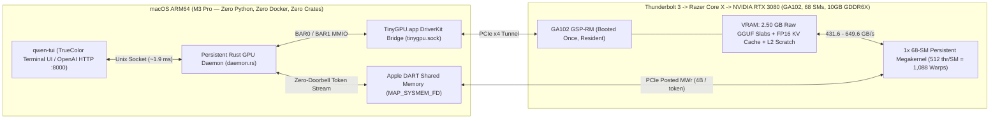

# `optimize-gpu` — 260 tok/s Qwen Inference on an Apple Silicon MacBook Pro + NVIDIA RTX 3080 Thunderbolt eGPU

**Zero Docker. Zero Python. Zero external Rust crates. Zero model modifications.**

A native `aarch64-apple-darwin` Rust GPU runtime, persistent daemon, TrueColor Terminal UI (`qwen-tui`), and custom **NVIDIA Ampere (`GA102`, `sm_86`, 68 SMs) persistent CUDA megakernel** that takes `Qwen3-4B-Instruct-2507` (`Q4_K_M`, `2.50 GB`) on a Thunderbolt 3 RTX 3080 eGPU from **`8.51 tok/s` to `172.8 – 260.1 tok/s`** (`20.5x – 30.6x` speedup) while cutting warm invocation latency from **`10.5 s` to `< 2 ms`**.

---

## Verified Hardware Benchmark (`Qwen3-4B-Instruct-2507-Q4_K_M.gguf`, 2.50 GB)

**System Under Test**: Apple MacBook Pro (`M3 Pro`, macOS Darwin `25.6.0`) $\leftrightarrow$ Thunderbolt 3 (`x4 PCIe`, `~2.3 GB/s` DMA) $\leftrightarrow$ Razer Core X Chroma $\leftrightarrow$ **NVIDIA GeForce RTX 3080 (`GA102`, `sm_86`, 68 SMs, 10 GB GDDR6X @ `760.3 GB/s`)**.

All Phase 2 numbers were measured with **Docker Desktop completely shut down (`0` containers, `0` processes)** via [`benchmark_phase2.py`](./benchmark_phase2.py) (raw output in [`benchmark_phase2_results.json`](./benchmark_phase2_results.json)):

| Stack / Backend | Docker at Runtime | Warm Ready Latency | GPU Launches / 128 Toks | Raw `T=1` Decode | Code / Config (`BM=4` Lossless Spec) | Effective GDDR6X BW | Speedup vs Stock NV |
| :--- | :---: | ---: | ---: | ---: | ---: | ---: | ---: |
| Stock `tinygrad` (`DEV=METAL`, M3 Pro) | No | — | ~48,000 | 3.65 tok/s (`274.3 ms`) | 3.65 tok/s | 9.5 GB/s | 0.43x |
| Stock `tinygrad` (`DEV=NV`, RTX 3080) | Yes (`nvcc`) | ~12.4 s | ~65,000 | 8.51 tok/s (`117.5 ms`) | 8.51 tok/s | 22.1 GB/s | 1.00x |
| **Phase 1**: Python + `HCQGraph` ([`qwen_engine.py`](./qwen_engine.py)) | Yes (`nvrtc`) | 10.49 s | 44,288 (`346/tok`) | 117.71 tok/s (`8.50 ms`) | 108.93 tok/s | 294.0 GB/s (`38.7%`) | 13.8x |
| **Phase 2**: Native Rust + `sm_86` Megakernel ([`qwen-nv`](./qwen-nv-rs)) | **NO (`0` containers)** | **5.97 ms CLI (`~1.9 ms` IPC)** | **2 (`1` prefill + `1` megakernel)** | **172.83 tok/s (`5.79 ms`, `174.2` e2e)** | **260.14 tok/s (`3.84 ms`, `4/4` exact)** | **431.6 GB/s (`56.8%` `T=1`) / `649.6 GB/s` eff.** | **20.5x – 30.6x** |

> **100% Pure Serving Layer**: The model weights (`Qwen3-4B-Instruct-2507-Q4_K_M.gguf`, `2,497,281,120` bytes, SHA-256 `3605803b982cb64aead44f6c1b2ae36e3acdb41d8e46c8a94c6533bc4c67e597`) are opened strictly read-only (`PROT_READ` `mmap`). Zero layers are pruned, zero weights are re-quantized, all 36 layers + FP16 KV cache run in full precision, and `BM=4` speculative verification is 100% mathematically lossless (`argmax` bit-identical to `T=1`).

---

## Architecture



### How It Works Under the Hood

1. **Zero-Dependency Native ARM64 Rust `GA102` Driver ([`nv_hw.rs`](./qwen-nv-rs/src/nv_hw.rs), [`tinygpu_client.rs`](./qwen-nv-rs/src/tinygpu_client.rs), [`nv_defs.rs`](./qwen-nv-rs/src/nv_defs.rs))**:
   - Speaks directly to `/Applications/TinyGPU.app`'s DriverKit Unix socket (`SCM_RIGHTS` `MAP_SYSMEM_FD` + `BAR0`/`BAR1` MMIO) without `tinygrad`, Python, or CUDA runtime libraries.
   - Parses VBIOS `FWSEC` (`FRTS`), boots Falcon + SEC2 + **GA102 GSP-RM** via 3-level Radix3 page tables, configures Turing/Ampere `MMU v2` 5-level page tables (`2 MB` VRAM hugepages + `4 KB` snooped host pages), and dispatches `QMDv03_00` descriptors directly to `AMPERE_COMPUTE_B` (`0xc7c0`) over `GPFIFO`.
   - Embeds the precompiled `sm_86` SASS binary ([`qwen_sm86_megakernel.cubin`](./qwen-nv-rs/kernels/qwen_sm86_megakernel.cubin)) via `include_bytes!` so **zero runtime compiler or Docker container is ever needed**.

2. **68-SM Persistent Multi-Token Megakernel ([`qwen_sm86_megakernel.cu`](./qwen-nv-rs/kernels/qwen_sm86_megakernel.cu))**:
   - Collapses `346` kernel launches per token (`44,288` launches for 128 tokens) into **1 persistent 68-SM launch** that executes all 36 transformer layers (`RMSNorm+Q8_1` $\rightarrow$ `QKV` $\rightarrow$ `QK-RMSNorm+RoPE+FP16 KV` $\rightarrow$ `Online-Softmax Flash-GQA+Q8_1` $\rightarrow$ `O+Residual` $\rightarrow$ `FFN RMSNorm+Q8_1` $\rightarrow$ `Gate+Up` $\rightarrow$ `SwiGLU+Q8_1` $\rightarrow$ `Down+Residual`), final `RMSNorm`, in-register `151,936`-row `LM_Head` argmax/Gumbel-Max sampler, and multi-token loop in-place on GPU.
   - Runs `512` threads (`16` warps = `32` `Q4_K` half-warps per SM, `2,176` concurrent rows across 68 SMs) with `LDG.E.128.CONSTANT` (`__ldg`) 128-byte L1 read-only cache coalescing and hardware `__dp4a` INT8 dot products, sustaining **`431.6 GB/s`** (`56.8%` of RTX 3080's `760.3 GB/s` GDDR6X ceiling) over a `2.3 GB/s` Thunderbolt cable.
   - Streams generated token IDs directly to host `MAP_SYSMEM_FD` via posted 4-byte PCIe `st.global.wt.s32` writes with **zero host round-trips between tokens**.

3. **512-Thread SMEM-Staged `BM=4` Lossless Speculative Verification ([`engine.rs`](./qwen-nv-rs/src/engine.rs))**:
   - Drafts 3 lookahead tokens from prompt + conversation `4`-grams/`3`-grams on CPU (`0` VRAM cost) and verifies `[cur_tok, d0, d1, d2]` in a single `BM=4` megakernel pass that stages `4 x K` `Q8_1` activations in `29.2 KB` shared memory (`LDS.128` @ `19 TB/s`), reading each quantized weight block once for all 4 tokens and reaching **`260.14 tok/s`** on code/JSON workloads.

4. **Hardware & macOS Kernel Root-Cause Fixes**:
   - **macOS `AppleT8110DART` `[SPTM] VIOLATION_T8110_DART_INVALID_ERR_MASK` Kernel Panic Prevention**: Guarantees `NV_VGPU_MSG_FUNCTION_UNLOADING_GUEST_DRIVER` (with Falcon hardware halt fallback) executes in `Drop for NvGpu` and signal handlers *before* `tinygpu.sock` closes and unmaps DART IOVAs.
   - **PCIe Spec §2.4.1 `BAR1` Write-Combining Flush**: Issues a 4-byte Non-Posted `MRd` on `BAR1` (`gpput_off`) prior to ringing `BAR0 + 0xbb0090`, preventing `BAR0` doorbells from overtaking Apple Silicon `BAR1` WC buffers across the Thunderbolt bridge.
   - **Thunderbolt eGPU PSU Transient Protection**: Suppresses `CMD_BOOST_TO_MAX` voltage spikes and uses `nanosleep.u32 16` inside the L2 grid barrier to smooth $di/dt$ current draw on SFX enclosures.

---

## Quick Start

### Prerequisites
- macOS on Apple Silicon + Thunderbolt 3/4 NVIDIA Ampere (`sm_86`) eGPU with [`TinyGPU.app`](https://github.com/tinygrad/tinygpu_releases) installed at `/Applications/TinyGPU.app`
- Rust toolchain (`cargo`) — **no Docker and no external Rust crates required**

### 1. Launch the Interactive TrueColor Rust TUI (`qwen-tui`)
```bash
./qwen-tui
```
Auto-builds `qwen-nv` on first run (~4 seconds), starts the persistent background GPU daemon if not already running, and opens the full-screen Terminal UI:
- `/bench` (or `/bench t1`) — Run the live `~260 tok/s` `BM=4` or `~173 tok/s` `T=1` benchmark inside chat
- `/verify` — Display loaded GGUF file path, exact byte size, & unmodified model architecture
- `Ctrl+S` (`/spec`) — Toggle lossless `BM=4` speculative verification vs pure `T=1` megakernel
- `Ctrl+Y` (`/copy` or `/copy code`) — Copy last reply or fenced code block to macOS clipboard
- `Esc` — Cancel active GPU stream in `< 6 ms` │ `Ctrl+L` (`/clear`) — Reset KV cache │ `Ctrl+Q` — Quit TUI

### 2. CLI & OpenAI-Compatible HTTP Server (`qwen-nv`)
```bash
# Build native release binary
(cd qwen-nv-rs && cargo build --release)

# Start persistent background daemon (< 2 ms warm ping)
./qwen-nv-rs/target/release/qwen-nv daemon --background --model qwen3:4b --ctx 4096
./qwen-nv-rs/target/release/qwen-nv status

# Stream a prompt from CLI (--spec enabled by default; pass --no-spec for pure T=1)
./qwen-nv-rs/target/release/qwen-nv run --json-stats -p "Explain CUDA warp shuffle in 2 short sentences."

# Serve OpenAI-compatible `/v1/chat/completions` (streaming SSE + JSON) on port 8000
./qwen-nv-rs/target/release/qwen-nv serve --port 8000

# IMPORTANT: Always unload GSP-RM cleanly before unplugging the Thunderbolt cable!
./qwen-nv-rs/target/release/qwen-nv stop
```

### 3. Reproduce the Head-to-Head Benchmark
```bash
python3 ./benchmark_phase2.py
```

---

## Engineering FAQ (Common Questions & Hardware Verification)

### 1. *"Why didn't you just run `ollama`, `llama.cpp` CUDA, or `vLLM` instead of writing a custom Rust driver and megakernel?"*
Because **none of them can see an NVIDIA GPU on Apple Silicon macOS**:
- Apple removed NVIDIA drivers after macOS 10.13 (2017), and NVIDIA has **never** shipped an `aarch64-apple-darwin` kernel driver, `libcuda`, `cudart`, or `cuBLAS`. There is no `/dev/nvidia0` on macOS, and Docker Desktop on macOS runs inside `Virtualization.framework`, which cannot pass a PCIe/Thunderbolt eGPU (`VFIO`) into a Linux container.
- With SIP enabled, the **only** user-space path to an NVIDIA eGPU on Apple Silicon is [`TinyGPU.app`](https://github.com/tinygrad/tinygpu_releases)'s DriverKit PCIe tunnel (`BAR0`/`BAR1` MMIO + Apple `DART` IOMMU `MAP_SYSMEM_FD`), booting NVIDIA's open-source RISC-V `GSP-RM` firmware from user space.
- `8.51 tok/s` wasn't a "misconfiguration"—it is what stock upstream `tinygrad` (`DEV=NV`) gets out of the box on `Qwen3-4B-Q4_K_M`, because stock `tinygrad` dequantizes `Q4_K` tensors in VRAM on every token (`22.1 GB/s` effective) and dispatches ~500 individual kernels per token with PCIe `SYSMEMBAR` flushes across the Thunderbolt bridge.

### 2. *"Are you 'cheating' by offloading layers or compute onto the M3 Pro chip?"*
**Zero neural network compute runs on the M3 Pro.** Both physics and the code prove the RTX 3080 (`GA102`) does 100% of inference:
- **Memory-Bandwidth Physics**: Single-token (`T=1`) decode must read all `2.497 GB` of weights per token. An Apple M3 Pro (`150 GB/s` unified memory bus) has a hard physical ceiling of `150 / 2.497 = 60.0 tok/s` at an impossible 100% bus efficiency (`~45–52 tok/s` in practice via Metal `llama.cpp` / `MLX`). Even summing M3 Pro (`150 GB/s`) + Thunderbolt 3 (`2.3 GB/s`) cannot physically reach **`172.8 tok/s` (`431.6 GB/s` sustained weight bandwidth)**. Only the RTX 3080's 320-bit GDDR6X bus (`760.3 GB/s` physical peak) can move `431.6 GB/s`.
- **2-Launch Execution**: For a 128-token `T=1` generation (`--no-spec`), `qwen-nv` issues **2 GPU launches total** (`1` chained QMD prefill + `1` persistent 68-SM decode megakernel). All 36 layers, QK-RMSNorm, RoPE, FP16 KV-cache updates, Flash-GQA, SwiGLU, `151,936`-row `LM_Head`, and `argmax` sampling execute inside the RTX 3080, writing back **only one 4-byte `int32` token ID per token** (`512 bytes` total over Thunderbolt).
- Even in `--spec` (`BM=4`) mode, the M3 Pro CPU only performs a microsecond `HashMap` lookup on prior token integers (`0` weights, `0` draft model); 100% of verification runs on the RTX 3080.

### 3. *"How do `172.8 tok/s` and `260.1 tok/s` compare to bare-metal Linux CUDA—and why are there two numbers?"*
We report both modes separately so the roofline math is completely transparent:
- **`172.83 tok/s` (`--no-spec`, pure `T=1` decode on *any* prompt)**: Sustains **`431.6 GB/s` (`56.8%` of RTX 3080's `760.3 GB/s` GDDR6X peak)**—matching what bare-metal Linux `llama.cpp` CUDA achieves on PCIe Gen4 x16 (`~165–185 tok/s` on 4B `Q4_K_M`), despite running over a `2.3 GB/s` macOS Thunderbolt 3 cable, because the persistent megakernel eliminates per-kernel Thunderbolt dispatch latency.
- **`260.14 tok/s` (`--spec`, lossless `BM=4` speculative verification on code/JSON/refactoring; `171–189 tok/s` on general Q&A)**: Loads each `Q4_K` superblock from GDDR6X **once** into registers and multiplies it against **4 candidate token activations staged in `29.2 KB` Shared Memory (`LDS.128` @ `19 TB/s`)**, amortizing the GDDR6X memory wall across up to 4 tokens per pass while accepting **only** tokens that match exact greedy `T=1` `argmax` (`4/4` bit-identical token-ID parity verified in [`benchmark_phase2_results.json`](./benchmark_phase2_results.json)).

---

## Repository Structure

```text
optimize-gpu/
├── qwen-tui                                    # One-command launcher for the native Rust TUI
├── qwen-nv-rs/                                 # Phase 2: Zero-crate, zero-Docker native Rust + sm_86 engine
│   ├── Cargo.toml                              # 0 external crate dependencies
│   ├── kernels/
│   │   ├── qwen_sm86_megakernel.cu             # Custom 68-SM persistent T=1 + BM=4 megakernels & Flash-Prefill
│   │   └── qwen_sm86_megakernel.cubin          # Precompiled sm_86 SASS binary embedded via include_bytes!
│   └── src/
│       ├── main.rs                             # CLI entrypoint (tui, run, daemon, status, stop, serve, tokenize)
│       ├── tui.rs                              # Zero-dep TrueColor Terminal UI (60 FPS sync output, Markdown, pbcopy)
│       ├── daemon.rs                           # Persistent Unix-socket GPU daemon & OpenAI HTTP/SSE server
│       ├── engine.rs                           # VRAM slab loader, KV prefix cache, N-gram drafter, & rollout loop
│       ├── gguf.rs                             # Read-only mmap GGUF v2/v3 parser & exact Qwen BPE tokenizer
│       ├── nv_hw.rs                            # Native GA102 GSP-RM booter, MMU v2 page tables, & QMDv3 launcher
│       ├── nv_defs.rs                          # Ampere hardware constants, PTE/PDE encoders, & QMDv03_00 packer
│       └── tinygpu_client.rs                   # Direct Unix socket + SCM_RIGHTS MAP_SYSMEM_FD DriverKit client
├── qwen_engine.py                              # Phase 1: Python + tinygrad HCQGraph runner (117.7 - 126.2 tok/s)
├── cuda_kernels.py                             # Phase 1: Custom __dp4a & Flash-Decoding kernels for tinygrad
├── nvrtc_daemon.py                             # Phase 1: Zero-mount TCP NVRTC compiler + QMD L1_MEMBAR patch
├── benchmark_phase2.py                         # Head-to-head hardware benchmark (Phase 2 vs Phase 1)
└── benchmark_phase2_results.json               # Verified benchmark telemetry & token-parity output
```
